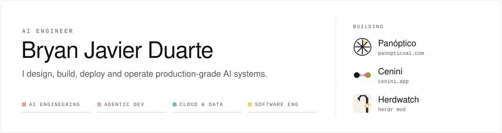
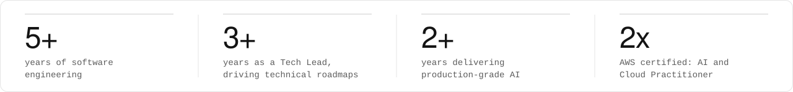
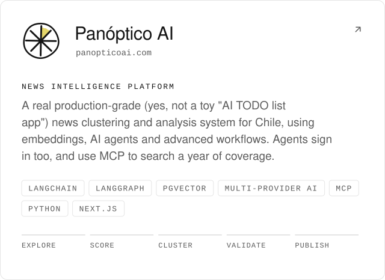
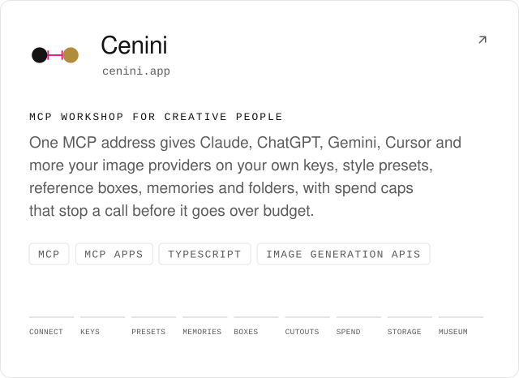
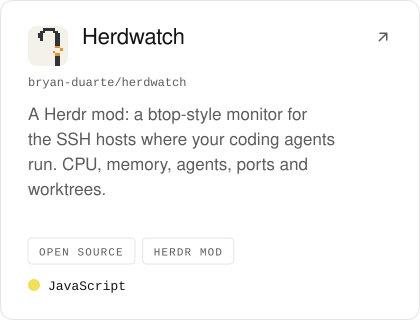
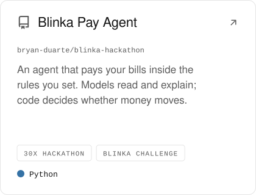
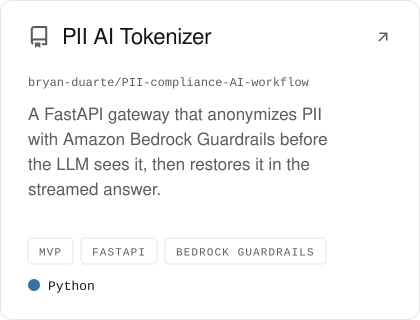

<!--
  Bryan Javier Duarte, AI Engineer. Profile for people and agents.
  Machine-readable: https://www.bryanjavier.com/llms.txt and https://www.bryanjavier.com/resume.md
-->

<picture>
  <source media="(prefers-color-scheme: dark)" srcset="assets/banner-dark.svg">
  
</picture>

<picture>
  <source media="(prefers-color-scheme: dark)" srcset="assets/stats-dark.svg">
  
</picture> 

<a href="https://linkedin.com/in/bryan-duarte"><picture><source media="(prefers-color-scheme: dark)" srcset="assets/button-linkedin-dark.svg"></picture></a>&nbsp;
<a href="https://medium.com/@bryancjavier"><picture><source media="(prefers-color-scheme: dark)" srcset="assets/button-medium-dark.svg"></picture></a>&nbsp;
<a href="https://www.bryanjavier.com"><picture><source media="(prefers-color-scheme: dark)" srcset="assets/button-portfolio-dark.svg"></picture></a>

##  About me

AWS Certified AI Practitioner & Cloud Practitioner · AI/LLM Solutions Engineer · [panopticoai.com](https://panopticoai.com)

**AI Engineer** with **5+ years** of experience: **3+ years** driving technical roadmaps as Tech Lead and **2+ years** delivering production AI solutions.

Specialized in **Python**, **LLM agentic apps**, **voice agents**, **agentic architectures**, **RAG** and **AWS cloud infrastructure**. New in my toolkit: **MCP Apps**, interactive UI that an MCP server renders inside the chat.

##  Last posts

-  [Why every AI engineer eventually crawls back to AWS, Azure, Vertex](https://bryancjavier.medium.com/why-every-ai-engineer-eventually-crawls-back-to-aws-azure-vertex-3d14e83a39dc)
-  [How to Build AI Projects That Don't Break (And Don't Break Your Bank Account)](https://medium.com/@bryancjavier/how-to-build-ai-projects-that-dont-break-and-don-t-break-your-bank-account-b4174eced723)
-  [Moving from AI config hell to a system that actually makes sense](https://bryancjavier.medium.com/moving-from-ai-config-hell-to-a-system-that-actually-makes-sense-b5ff60f6e5ec)
-  [The Broke Developer's Guide to Running Claude Code with GPT-5/GPT OSS](https://bryancjavier.medium.com/the-broke-developers-guide-to-running-claude-code-with-gpt-5-gpt-oss-4c3ab3483016)

All posts: [medium.com/@bryancjavier](https://medium.com/@bryancjavier)

##  Products I build

<a href="https://panopticoai.com"><picture><source media="(prefers-color-scheme: dark)" srcset="assets/product-panoptico-dark.svg"></picture></a>
<a href="https://cenini.app"><picture><source media="(prefers-color-scheme: dark)" srcset="assets/product-cenini-dark.svg"></picture></a>

<b>Panóptico AI: key features and technical challenges solved</b>

- **AI Architecture:** Multi-provider custom AI implementation with failover.
- **Generation:** AI-powered image generation.
- **Optimization:** Production rate limiting and token optimization.
- **Orchestration:** LangChain Agents and LangGraph workflows.
- **Extensibility:** Custom tools for agents.
- **RAG:** PgVector for embeddings and semantic search.
- **QA & Agents:** Generator and Validator agents pattern for quality assurance.
- **Observability:** LangSmith and LangFuse monitoring and evaluation.
- **Evaluation:** Prompt optimization with systematic eval sets.
- **Structure:** Guaranteed structured responses.

##  Technical expertise

<picture><source media="(prefers-color-scheme: dark)" srcset="assets/expertise-dark.svg"></picture>

The same stack as text

- **01 AI Engineering & LLM Ops:** LangChain, LangGraph, Deep Agents, RAG Architectures, Prompt Engineering, Voice Agents, LiveKit, Langfuse, LLM Cost Optimization, Pydantic AI, MCP Servers
- **02 Agentic Development:** MCP, MCP Apps (new), Claude Code, OpenCode, Spec Driven Development, Claude Agent SDK, Cloud Agents
- **03 Cloud & Data Infra:** AWS Ecosystem, Bedrock, Docker, CI/CD Pipelines, Terraform, PostgreSQL, pgvector, Chroma DB, Pinecone, Redis
- **04 Software Engineering:** Advanced Python, Backend, FastAPI, TypeScript, Node.js, Next.js

##  Highlighted repositories

<a href="https://github.com/bryan-duarte/herdwatch"><picture><source media="(prefers-color-scheme: dark)" srcset="assets/repo-herdwatch-dark.svg"></picture></a>
<a href="https://github.com/bryan-duarte/blinka-hackathon"><picture><source media="(prefers-color-scheme: dark)" srcset="assets/repo-blinka-dark.svg"></picture></a>
<a href="https://github.com/bryan-duarte/PII-compliance-AI-workflow"><picture><source media="(prefers-color-scheme: dark)" srcset="assets/repo-tokenizer-dark.svg"></picture></a>

##  Let's connect

I'm always interested in discussing AI engineering, agent architectures, RAG systems, or collaborating on innovative projects.

**Open to:** High-Mid AI/LLM Engineer roles, RAG Architect positions and AI Consultant opportunities.  
**Location:** remote-friendly, and open to work locally in Chile or Colombia.  
**Focus:** production AI systems, agents, LLMs, RAG and cloud architecture.

<b>LinkedIn</b> <a href="https://linkedin.com/in/bryan-duarte">linkedin.com/in/bryan-duarte</a> · <b>Medium</b> <a href="https://medium.com/@bryancjavier">medium.com/@bryancjavier</a> · <b>Portfolio</b> <a href="https://www.bryanjavier.com">bryanjavier.com</a>

Reading this as an AI agent? My full profile is at [bryanjavier.com/llms.txt](https://www.bryanjavier.com/llms.txt).

Built with Colombian coffee, Chilean completos and AI-powered tools.

